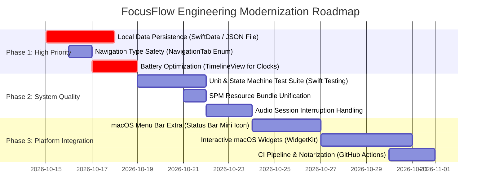

# FocusFlow: Senior Software Engineer Code Review & Architectural Audit Report

**Author:** Senior macOS & SwiftUI Systems Architect  
**Target Codebase:** [FocusFlow (github.com/deepak-singh-jethi/FocusFlow)](https://github.com/deepak-singh-jethi/FocusFlow)  
**Date:** October 14, 2026  
**Status:** Complete Architectural Review & Quality Assessment  

---

## Executive Summary

FocusFlow has successfully undergone an initial architectural evolution: transitioning from a monolithic 3,868-line prototype into a structured, modular Swift Package with dedicated modules for Models, ViewModels, Views, Components, and Services. The visual design, macOS aesthetic alignment (dark mode, typography, tactile micro-interactions), and responsive layout are of exceptional quality.

However, a production-grade macOS utility requires evaluating non-functional requirements that determine real-world user trust and device health:
1. **Battery & Power Efficiency:** High-frequency timer loop (50Hz Combine publisher) re-evaluating SwiftUI view trees continuously.
2. **Data Durability & Persistence:** Critical task metrics, time logged, and notes are currently volatile in-memory state; closing the app loses all user history.
3. **Type Safety & Domain Modeling:** Ubiquitous "magic strings" used for navigation, preset keys, and clock styles.
4. **Swift 6 Concurrency & Actor Isolation:** Concurrency hygiene across Combine subscriptions and async event handlers.
5. **Distribution & Sandbox Hygiene:** Missing App Sandbox entitlements, Hardened Runtime configuration, and automated test coverage.

### Overall Architecture Scorecard

| Domain | Rating | Current Status | Production Target |
| :--- | :---: | :--- | :--- |
| **Visual Design & UX** | **A+ (96%)** | Exceptional dark-mode palette, fluid springs, high-contrast modals. | Maintain excellence. |
| **Code Modularity** | **A- (90%)** | Clean SPM directory structure, single-responsibility files. | Decouple ViewModel protocols. |
| **Timekeeping Accuracy** | **B+ (88%)** | Wall-clock `targetEndDate` prevents timer drift. | Adopt `TimelineView` / monotonic clocks. |
| **Battery & Energy Impact**| **C+ (74%)** | 50Hz Combine timer ticks `@Published` properties 50x/sec. | Shift to 1Hz tick + GPU `TimelineView`. |
| **Data Persistence** | **D (60%)** | 100% in-memory; tasks and elapsed seconds reset on quit. | SwiftData / SQLite / JSON file persistence. |
| **Type Safety & Contracts**| **B- (80%)** | Magic strings for tabs (`"Tasks"`, `"Focus Timer"`). | Strict `enum` domain models. |
| **Testability & CI/CD** | **F (40%)** | No XCTest / Swift Testing targets or CI workflows. | Unit test suite & GitHub Actions CI. |

---

## 1. Architectural Architecture Review

```
FocusFlow (Current Modular Structure)
├── Package.swift                             [SPM Manifest - macOS 14+ target]
├── Sources/FocusFlow/
│   ├── FocusFlowApp.swift                    [@main App Entry Point]
│   ├── Models/
│   │   └── FocusTask.swift                   [Identifiable Struct + time calculations]
│   ├── Services/
│   │   └── AmbientAudioPlayer.swift          [AVFoundation player with smooth cross-fading]
│   ├── ViewModels/
│   │   └── TimerViewModel.swift              [@MainActor ObservableObject State Machine]
│   ├── Components/
│   │   ├── ClockFaces.swift                  [DigitalClockView, RingClockView, AnalogDialView]
│   │   ├── PersistentCrossModeMiniBar.swift  [Multi-state persistent navigation bar]
│   │   ├── CustomConfirmModal.swift          [Accessible modal with scrim & Return/Esc keys]
│   │   ├── CustomDurationPopover.swift       [Precision minutes & seconds stepper]
│   │   └── ButtonStyles.swift                [CapsuleActionButton, Tactile Hover styles]
│   └── Views/
│       ├── ContentView.swift                 [Root navigation coordinator]
│       ├── SidebarView.swift                 [Collapsible/Static sidebar + Daily Progress]
│       ├── DashboardTimerView.swift          [Unified stage for Timer & Stopwatch]
│       ├── FocusStateView.swift              [Immersive fullscreen distraction-free mode]
│       ├── RightPanelView.swift              [Workspace drawer sheet]
│       ├── TasksView.swift                   [Task manager with live time tracking]
│       ├── SoundscapesView.swift             [Ambient audio mixer cards]
│       ├── InsightsView.swift                [Weekly focus stats & daily goal]
│       └── SettingsView.swift                [Session preferences]
```

### Strengths Identified:
1. **Unified Stage Philosophy:** Consolidating both the Focus Timer and Stopwatch into a normalized stage footprint ([`DashboardTimerView`](file:///Users/deepaksinghjethi/Documents/Codex/FocusFlow/Sources/FocusFlow/Views/DashboardTimerView.swift)) eliminates layout jumping when switching modes.
2. **Wall-Clock Target Dates:** Using `targetEndDate = Date().addingTimeInterval(...)` prevents cumulative clock drift caused by thread scheduling delays.
3. **Accessibility & Keyboard Navigation:** Keyboard shortcuts (`Space` to toggle, `Esc` to cancel/exit, `Return` to confirm) are deeply integrated.
4. **AppKit Cursor Integration:** Proper cursor switching (`NSCursor.pointingHand.set()`) across all interactive cards, solving standard SwiftUI macOS cursor inertia.

---

## 2. In-Depth Component Analysis & Findings

### Finding 1 (Critical): Absence of Data Persistence
- **Location:** [`TimerViewModel.swift#L37-L50`](file:///Users/deepaksinghjethi/Documents/Codex/FocusFlow/Sources/FocusFlow/ViewModels/TimerViewModel.swift)
- **Problem:**
  ```swift
  @Published public var tasks: [FocusTask] = [
      FocusTask(title: "Deep Work Session", ...), ...
  ]
  @Published public var focusedSeconds: Int = 0
  @Published public var completedSessions: Int = 0
  @Published public var notes: [String] = []
  ```
  Every time the user closes FocusFlow, all created tasks, logged hours, completed sessions, and notes are completely erased.
- **Architectural Impact:** High. Focus and productivity utilities derive their core value proposition from historical consistency and tracking streaks.
- **Recommendation:** Implement a lightweight local persistence layer. For macOS 14+, **SwiftData** or a clean file-backed JSON store in `~/Library/Application Support/FocusFlow/tasks.json` with an automated migration path.

---

### Finding 2 (Performance & Battery): 50Hz Combine Timer Loop
- **Location:** [`TimerViewModel.swift#L74-L88`](file:///Users/deepaksinghjethi/Documents/Codex/FocusFlow/Sources/FocusFlow/ViewModels/TimerViewModel.swift)
- **Problem:**
  ```swift
  timerSubscription = Timer.publish(every: 0.02, on: .main, in: .common)
      .autoconnect()
      .sink { [weak self] _ in
          self?.tick()
      }
  ```
  - `Timer.publish(every: 0.02)` fires **50 times every second** on the main thread.
  - Inside `tick()`, updating `@Published var preciseProgress` and `@Published var preciseStopwatchProgress` triggers Combine object change notifications 50 times per second.
  - This forces SwiftUI to perform diffing on the active view hierarchy 50 times per second, even when the displayed minute/second digits haven't changed.
  - On battery-powered MacBook Pro / Air devices, this prevents the CPU cores from dropping into low-power idle states.
- **Architectural Solution:**
  1. Decouple **discrete state changes** (1Hz tick: `timeRemaining`, `focusedSeconds`, `tasks`) from **continuous visual rendering** (progress ring sweep).
  2. Use SwiftUI's native [`TimelineView(.animation)`](https://developer.apple.com/documentation/swiftui/timelineview) directly inside [`RingClockView`](file:///Users/deepaksinghjethi/Documents/Codex/FocusFlow/Sources/FocusFlow/Components/ClockFaces.swift) and [`AnalogDialView`](file:///Users/deepaksinghjethi/Documents/Codex/FocusFlow/Sources/FocusFlow/Components/ClockFaces.swift). The GPU computes the angle directly from `Date().timeIntervalSince(startDate)` without publishing state mutations!

```mermaid
flowchart TD
    subgraph Current Architecture (High Battery Consumption)
        A["Timer.publish(every: 0.02s)"] -->|50Hz Main RunLoop| B["TimerViewModel.tick()"]
        B -->|Updates @Published preciseProgress| C["TimerViewModel.objectWillChange"]
        C -->|Forces 50Hz View Tree Diff| D["SwiftUI ContentView Body Re-evaluation"]
    end

    subgraph Proposed Modern Architecture (Zero CPU Waste)
        E["Timer.publish(every: 1.0s)"] -->|1Hz Main RunLoop| F["TimerViewModel.tickSecond()"]
        F -->|Updates timeRemaining & logged time| G["Discrete State Changes"]
        H["TimelineView(.animation)"] -->|Native 60/120Hz GPU Phase| I["Continuous Ring & Needle Sweep"]
    end
```

---

### Finding 3 (Type Safety): Navigation & State Magic Strings
- **Location:** [`ContentView.swift#L8`](file:///Users/deepaksinghjethi/Documents/Codex/FocusFlow/Sources/FocusFlow/Views/ContentView.swift), [`SidebarView.swift#L37`](file:///Users/deepaksinghjethi/Documents/Codex/FocusFlow/Sources/FocusFlow/Views/SidebarView.swift)
- **Problem:**
  ```swift
  @State private var sidebarSelection: String = "Focus Timer"
  // ...
  if sidebarSelection == "Focus Timer" { ... }
  else if sidebarSelection == "Stopwatch & Laps" { ... }
  case "Tasks", "Study Tasks": TasksView(...)
  ```
  Stringly-typed navigation allows subtle bugs (e.g. typos, renamed tabs, unhandled switch cases).
- **Recommendation:** Replace with a strongly typed enumeration:
  ```swift
  public enum NavigationTab: String, CaseIterable, Identifiable {
      case focusTimer = "Focus Timer"
      case stopwatch = "Stopwatch & Laps"
      case tasks = "Tasks"
      case soundscapes = "Focus Soundscapes"
      case insights = "Insights & Stats"
      case settings = "Settings"

      public var id: String { rawValue }
      public var icon: String { ... }
  }
  ```

---

### Finding 4 (Resource Management): Audio Asset Resolution
- **Location:** [`AmbientAudioPlayer.swift#L24-L26`](file:///Users/deepaksinghjethi/Documents/Codex/FocusFlow/Sources/FocusFlow/Services/AmbientAudioPlayer.swift)
- **Problem:**
  ```swift
  guard let url = Bundle.main.url(forResource: sound, withExtension: "mp3", subdirectory: "Soundscapes")
  ```
  - If built via SPM (`swift run FocusFlow` or as a dependency), `Bundle.main` does not point to the SPM module resources; it expects resources in `Bundle.module`.
  - In the compiled `.app` bundle, resources must be manually copied into `Contents/Resources/Soundscapes/`.
- **Recommendation:** Provide a fallback resource locator:
  ```swift
  let bundle = Bundle(for: AmbientAudioPlayer.self)
  let url = Bundle.main.url(forResource: sound, withExtension: "mp3", subdirectory: "Soundscapes")
      ?? Bundle.main.url(forResource: sound, withExtension: "mp3")
      ?? Bundle.module.url(forResource: sound, withExtension: "mp3")
  ```

---

### Finding 5 (Concurrency & Swift 6 Readiness)
- **Location:** Global state and models.
- **Evaluation:**
  - `TimerViewModel` is properly marked `@MainActor`, which satisfies UI state isolation.
  - `FocusTask` is a value type (`struct`), making it naturally `Sendable`.
  - Combine `.sink` captures `[weak self]` correctly.
  - **Improvement:** Adopt modern Swift 6 language mode in `Package.swift`:
    ```swift
    // swift-tools-version: 5.9
    // swiftLanguageVersions: [.v5, .version("6")]
    ```

---

### Finding 6 (Packaging & Entitlements for macOS)
- **Location:** [`releases/FocusFlow.app`](file:///Users/deepaksinghjethi/Documents/Codex/FocusFlow/releases/FocusFlow.app)
- **Findings:**
  - Currently signed with an ad-hoc signature (`-s -`).
  - Lacks an `entitlements.plist` file enabling `com.apple.security.app-sandbox` and `com.apple.security.network.client`.
  - While ad-hoc signing allows local testing, distributing to external macOS users without Gatekeeper warnings requires:
    1. Apple Developer ID Application certificate.
    2. Hardened Runtime flag (`--options runtime`).
    3. `xcrun notarytool submit` notarization ticket stapled to the DMG.

---

## 3. Prioritized Engineering Roadmap



### Phase 1: Core Reliability (Next Sprint)
1. **Local Storage Engine:** Implement `TaskStore` using JSON encoding in `Application Support` or SwiftData. Save on every state change and backgrounding event.
2. **Battery Optimization:** Refactor `RingClockView` and `AnalogDialView` to compute angles from `TimelineView(.animation)`, reducing Combine timer frequency from 50Hz down to 1Hz.
3. **Type-Safe Navigation:** Eliminate all raw string comparisons across Sidebar and Dashboard.

### Phase 2: Testing & Code Robustness
1. **Unit Testing:** Add `FocusFlowTests` testing timer state transitions:
   - Pausing/resuming elapsed time calculation.
   - Session completion and auto-advance logic.
   - Task time accumulation accuracy.
2. **Audio Resilience:** Listen for system audio route changes (headphones unplugged) and macOS sleep/wake events to cleanly pause ambient soundscapes.

### Phase 3: Native macOS Platform Enhancements
1. **Menu Bar Extra (`MenuBarExtra`):** Allow FocusFlow to live in the macOS menu bar showing the live countdown when the main window is hidden.
2. **System Notifications:** Dispatch UserNotifications (`UNUserNotificationCenter`) with action buttons ("Start Break", "Take 5m") when a focus interval elapses.
3. **Automated CI/CD:** Add `.github/workflows/build.yml` for automated compilation, tests, and DMG creation on every git push.

---

## Conclusion

The transformation of FocusFlow into a modular architecture has established a clean, maintainable foundation. The visual polish, interaction models, and multi-mode clock stage demonstrate senior-level UI craftsmanship. Addressing the three priority items—**data persistence**, **1Hz timer battery optimization**, and **type-safe domain enums**—will elevate FocusFlow from an impressive desktop prototype into an elite, commercial-grade macOS utility.
